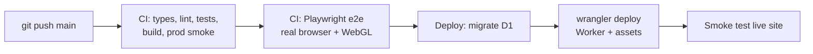

# Deploying Interview Tower

One Cloudflare Worker serves the static pages (straight from assets, unmetered) and the API (`/api/*`); D1 is the
database. Everything is on free tiers.

| Piece | Name |
|---|---|
| Repo | `aiengineerlabs-haohoang/interview-platform`, branch `main` |
| Worker | `interview-tower` |
| Database | D1 `interview-tower` (`59db948f-b8ba-48ef-bb04-0602dcc9106d`, APAC) |
| Account | `75a4838e7b7aca7fe2dcaf49036ae7b8` |
| Live | https://interview-tower.hao-hoang.workers.dev |



If any box fails, the ones after it do not run and the live site stays on the previous version.

## The one step a human has to do

CI deploys with a Cloudflare **API token**. `wrangler login` (OAuth) cannot be used in GitHub Actions and cannot mint
one, so this is the single piece that was not automated. Until it is done, CI runs every test and then prints
"Deploy skipped" as a warning.

1. https://dash.cloudflare.com/profile/api-tokens → **Create Token** → template **Edit Cloudflare Workers**.
   Restrict it to the account above. Add **Account → D1 → Edit** if the template does not include it.
2. In a terminal on your machine (so the token never goes through a chat):
   ```bash
   gh secret set CLOUDFLARE_API_TOKEN -R aiengineerlabs-haohoang/interview-platform
   ```
3. Re-run the last workflow (`gh run rerun --failed` or push any commit). The Deploy job now applies migrations,
   deploys and smoke-tests the live site.

Already set: secret `CLOUDFLARE_ACCOUNT_ID`; variables `D1_DATABASE_ID`, `SITE_URL`.

## Deploying from a laptop (works today)

```bash
export PATH=$HOME/.nvm/versions/node/v22.23.4/bin:$PATH
D1_DATABASE_ID=59db948f-b8ba-48ef-bb04-0602dcc9106d \
SITE_URL=https://interview-tower.hao-hoang.workers.dev \
npm run deploy
```

It builds the site, writes the production Worker config, applies pending D1 migrations to the remote database, deploys.

## A custom domain

Add the zone to Cloudflare, then `gh variable set CUSTOM_DOMAIN --body "<domain>"` and push. `prod-config.mjs` turns it
into a custom-domain route and sets `SITE_URL` from it. No data moves.

## Migrations

`apps/api/migrations/` is additive and numbered upwards. Migrations run **before** the new code goes out, so for a
moment the old code runs against the new schema: add columns and tables, never rename or drop in the same release.

`0002_accounts.sql` (users, sessions) needs no extra step: `wrangler d1 migrations apply` applies every numbered file, in
the Deploy workflow, in `scripts/deploy-local.sh` and in `scripts/serve-prod.sh` (so CI's smoke test and e2e run against
it; `scripts/prod-smoke.sh` registers an account to prove it). Passwords use PBKDF2-SHA256 at 100,000 iterations, the
most Workers allows. Sessions are cookies only (`Secure` over https), so there is no secret to configure.

## Rolling back

`cd apps/api && npx wrangler rollback -c wrangler.production.jsonc` returns the Worker and its assets to the previous
version. The database is not rolled back.

## Cost

Workers free: 100k requests/day, and static assets are not counted. D1 free: 5M reads and 100k writes a day. One
visitor writes about three rows a minute (heartbeat every 20 s), so the write budget is roughly 30k visitor-minutes a
day. If the building gets busy, lengthen `HEARTBEAT_MS` in `Tower.tsx` first.
